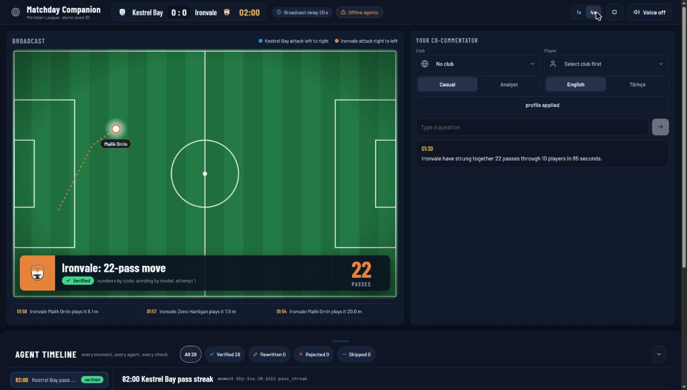
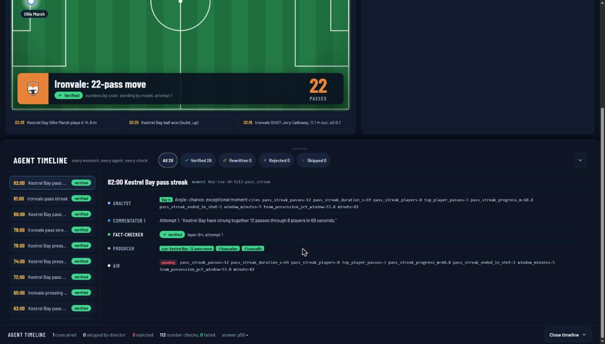
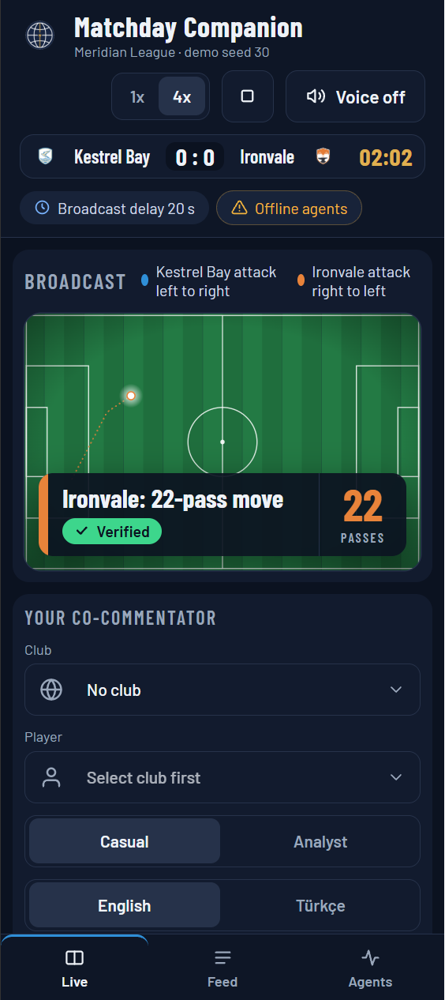
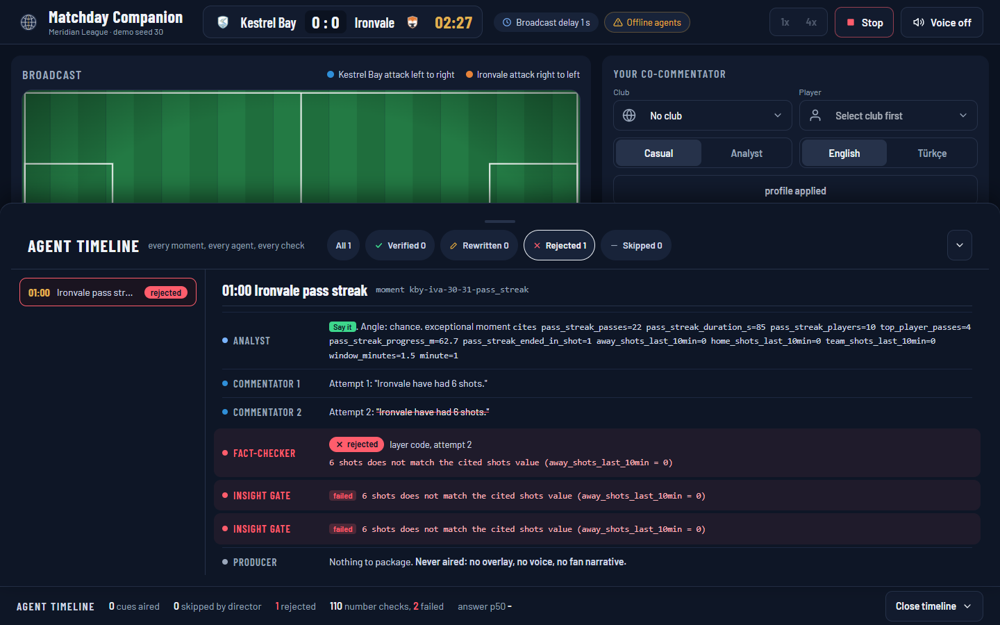
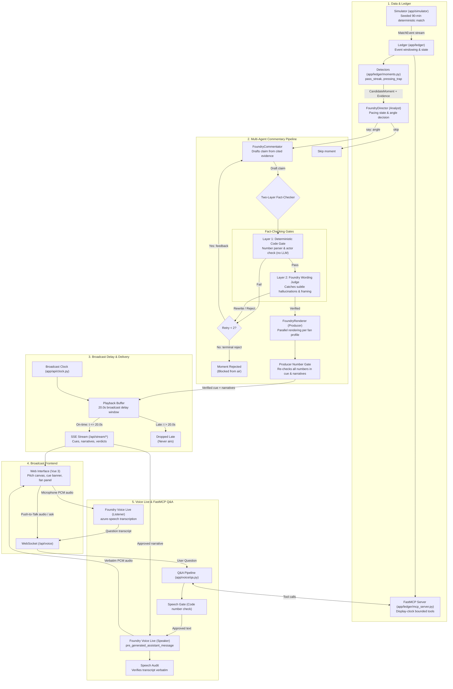
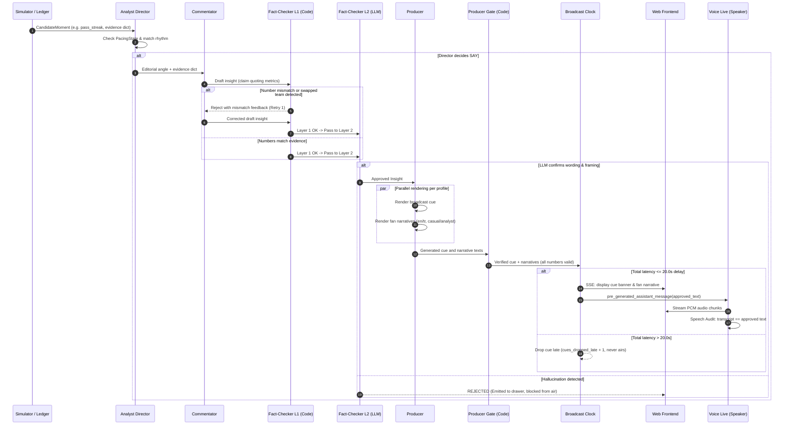
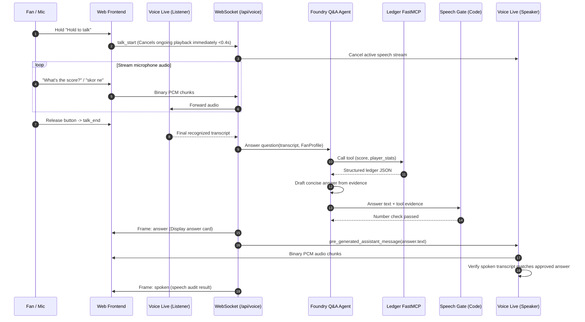

# Matchday Companion


**A live co-commentator you can interrupt, and that can't lie.**

[Try it (Public App)](https://ca-matchday.orangetree-bcef6d10.eastus2.azurecontainerapps.io) | [2-minute video](https://youtu.be/wi6E7SjbZjQ) | [Architecture](docs/architecture.md) | [Evaluation](docs/eval-results.md) | [Performance](docs/performance.md)

<a href="https://youtu.be/wi6E7SjbZjQ"></a>

[Watch the 2-minute demo on YouTube](https://youtu.be/wi6E7SjbZjQ)

---

### Core Proof Numbers

**Trust layer** (Foundry cloud evaluation, planted errors, seeds 7, 30, 42):

| Metric | With Fact-Checker | Without Fact-Checker | Source |
|---|---|---|---|
| **Planted errors reaching air** | **0 of 4** | 4 of 4 | [docs/eval-results.md](docs/eval-results.md) |
| **Groundedness (planted run)** | **4.75 / 5** (100% pass) | 3.83 / 5 (75% pass) | [docs/eval-results.md](docs/eval-results.md) |

**Live performance** (local live run, seed 30, before and after the performance pass):

| Metric | After | Before | Source |
|---|---|---|---|
| **Cues ready before air (20 s delay)** | **4 of 4** | 1 to 3 of 4 dropped late | [docs/performance.md](docs/performance.md) |
| **Fan question, press to answer (median)** | **4.66 s** | 11.76 s | [docs/performance.md](docs/performance.md) |
| **Spoken lines matching approved text** | **0 mismatches** in the measured run | | [docs/performance.md](docs/performance.md) |

---|---|---|---|
| **Planted Errors Reaching Air** | **0 of 4** (0%) | **4 of 4** (100%) | [docs/eval-results.md](docs/eval-results.md) |
| **Groundedness Score (Planted)** | **4.75 / 5.0** (100% pass) | **3.83 / 5.0** (75% pass) | [docs/eval-results.md](docs/eval-results.md) |
| **Cues Ready on Time (<20.0s)** | **100%** (0 of 4 late, seed 30) | **25% - 75%** late in unconstrained baseline | [docs/performance.md](docs/performance.md) |
| **Q&A Answer Latency (p50)** | **4.66 s** (2.8 s trace median) | **11.76 s** baseline live run | [docs/performance.md](docs/performance.md) |
| **Verbatim Speech Audit Match** | **100% exact** (0 mismatches) | | [docs/deploy.md](docs/deploy.md) |

---

## Why It Matters

Broadcasters cannot put an AI voice on live air if it might invent a statistic. A single hallucinated metric during a live football broadcast damages credibility and violates editorial standards. Matchday Companion provides the trust layer that makes live AI commentary viable: every number is extracted from deterministic match data, every statement is checked before it is shown, and every spoken word is audited against approved text.

The system serves two audiences simultaneously:
1. **The Broadcast Producer:** Receives verified, timely overlay cues that highlight emerging tactical patterns (e.g. sustained pressing traps, passing streaks) well within standard broadcast delay windows.
2. **The Fan:** Receives a personal, interruptible co-commentator in their language (English or Turkish) and at their preferred analytical depth (casual or analyst).

### Where It Fits in Broadcast Production

In a live broadcast production chain, Matchday Companion sits directly between the incoming event telemetry stream and the on-air graphics / second-screen playout. Rather than replacing human commentators, it augments production teams by generating and verifying data-backed storylines faster than manual research permits. The simulator emits one event schema (below); a real feed would plug in through an adapter that maps its events to the same schema. No real feed integration is claimed. Playout graphics and synthesized audio are held behind a calibrated 20.0-second broadcast delay, ensuring that only fully verified insights ever reach air.

---

## What You See

### Broadcast Overlay Cue and Agent Timeline
The desktop broadcast interface displays the real-time pitch view, live event ticker, and verified lower-third cue banner alongside an inspectable agent timeline drawer:

| Desktop Live Cue Banner | Open Agent Timeline Drawer |
|---|---|
|  |  |
| *Verified lower-third cue banner and glowing pitch action during live match play.* | *The multi-agent drawer showing Director decision, Commentator attempts, Fact-Checker verdict, and Producer outputs.* |

### Mobile Fan Experience and Planted Error Rejection

| Responsive Mobile View | Fact-Checker Rejection (Scene 5) |
|---|---|
|  |  |
| *Compact phone layout with scoreboard pill, verified cue banner, push-to-talk button, and audio waveform.* | *Layer 1 deterministic code check intercepting an injected false claim (6 shots) and blocking it before broadcast.* |

---

## Try It in 2 Minutes

### 1. Judge Path (90-Second Public Walk-Through)

Open the public application:
**https://ca-matchday.orangetree-bcef6d10.eastus2.azurecontainerapps.io**

1. **Start the Match:** Press **Start match**. Select **1x** speed for live Microsoft Foundry multi-agent execution, or **4x** speed for precomputed verdict playback.
2. **Enable Voice:** Toggle the **Voice** switch to activate Microsoft Foundry Voice Live streaming.
3. **Ask a Question (Barge-In):** Press and hold **Hold to talk** and ask: *"How is my player doing?"* or *"What is the score?"* (or Turkish *"skor ne"*). Notice that speaking immediately halts ongoing audio (<0.4 s), queries ledger tools over FastMCP, and returns an audited spoken answer.
4. **Inspect the Trust Layer:** Click **Open timeline** in the footer (on a phone: the **Agents** tab) to open the timeline drawer. Inspect the decisions made by the Analyst Director, Commentator drafts, Layer 1 and Layer 2 Fact-Checker checks, and Producer outputs.

> **Public Demo Limits:** To protect hackathon spend while preserving reproducibility, the public instance permits **2 live match runs per visitor IP per day** with a **global cap of 40 live runs daily** (`PUBLIC_LIVE_RUNS_TOTAL_PER_DAY=40`). Once reached, the application falls back seamlessly to offline template agents with an explicit notice.

---

### 2. Local Run (No Azure Credentials Required)

Run the full application locally in offline mode using Docker Compose:

```bash
docker compose up --build
```

Open `http://localhost:8010` in your browser. The application runs with deterministic template agents and local FastMCP ledger tools.

---

### 3. Local Run with Microsoft Foundry

To run against live Microsoft Foundry deployments:

1. Copy `.env.example` to `.env` and configure your Foundry project endpoint and model deployments:
   ```bash
   FOUNDRY_PROJECT_ENDPOINT=https://<resource>.services.ai.azure.com/api/projects/<project>
   SMALL_MODEL_DEPLOYMENT=gpt-5.4-mini
   AGENT_MODE=foundry
   VOICE_MODE=live
   ```
2. Log in with Azure CLI:
   ```bash
   az login
   ```
   *(On Windows machines where the CLI WAM broker causes issues, set `AZURE_CORE_ENABLE_BROKER_ON_WINDOWS=false`)*
3. Install dependencies and launch:
   ```bash
   pip install -r requirements.txt
   python -m uvicorn app.api.main:app --port 8010
   ```

---

### 4. Reproducibility Commands

- **Replay Seed 30 Offline:**
  ```bash
  python -m app.agents.run_match --seed 30 --speed 30
  ```
- **Planted-error check, offline (code gates only, no Azure):**
  ```bash
  python -m app.agents.run_match --seed 30 --plant 6
  ```
  Expected last line: `caught 38 of 38 planted errors, 0 reached air` (wrong numbers, missing keys, swapped teams, changed or dropped numbers and numbers as words, in English and Turkish).
- **Re-run the Foundry evaluation (needs Azure; results land in `runs/eval`, then render the report):**
  ```bash
  python -m app.eval.run_eval
  python -m app.eval.run_eval --render-only
  ```
- **Run Offline Test Suite:**
  ```bash
  python -m pytest tests -q
  ```

---

## Architecture

Matchday Companion decouples raw event generation, deterministic metric aggregation, agent commentary, fact-checking, and playback timing:



### Execution Sequences

#### Sequence A: Moment Ingest, Verification, and Air Playout



#### Sequence B: Push-to-Talk Fan Question over FastMCP



For extended details on every pipeline stage, see [docs/architecture.md](docs/architecture.md).

---

## Pipeline Stages

| Stage | Name | Implementation | Function | Inputs | Outputs | Gating / Guarantees |
|---|---|---|---|---|---|---|
| **1** | Simulator | Code ([app/simulator/engine.py](app/simulator/engine.py)) | Emits seeded match events | Seed (int), clock | `MatchEvent` stream | Deterministic; same seed gives identical events. |
| **2** | Ledger | Code ([app/ledger/state.py](app/ledger/state.py)) | Calculates possession, pass streaks, pressing traps | Events list | `CandidateMoment` + `evidence` | Deterministic calculations; source of truth. |
| **3** | FastMCP | FastMCP ([app/ledger/mcp_server.py](app/ledger/mcp_server.py)) | Exposes read-only ledger tools (`score`, `player_stats`, etc.) | Tool request | Structured JSON | Bounded by display clock; no future event leakage. |
| **4** | Director | Foundry ([app/agents/analyst.py](app/agents/analyst.py)) | Evaluates pacing and decides whether to speak or skip | Moment, `PacingState` | `DirectorDecision` | Max tokens: 100. Skips low-interest moments. |
| **5** | Commentator | Foundry ([app/agents/commentator.py](app/agents/commentator.py)) | Drafts claim citing specific ledger evidence keys | Moment, labels | `Insight` draft | Max tokens: 250. Cites only evidence metrics. |
| **6** | Fact-Checker L1 | Code ([app/agents/fact_check_rules.py](app/agents/fact_check_rules.py)) | Parses numbers; verifies exact matches; checks actors | Claim, evidence dict | `NumberCheck` | Deterministic code; rejects mismatched numbers instantly. |
| **7** | Fact-Checker L2 | Foundry ([app/agents/fact_checker.py](app/agents/fact_checker.py)) | Evaluates framing, tone, and qualitative claims | Insight, evidence | `Verdict` | Max tokens: 250. Blocks claims that pass code but mislead. |
| **8** | Producer | Foundry ([app/agents/producer.py](app/agents/producer.py)) | Renders verified insight into multi-profile cues/narratives | Verified insight | `ProducerOutput` | Max tokens: 120 (cue), 180 (narrative). En/Tr, casual/analyst. |
| **9** | Producer Gate | Code ([app/agents/fact_check_rules.py](app/agents/fact_check_rules.py)) | Re-verifies numbers across all rendered profile outputs | Rendered text, evidence | `NumberCheck` | Zero tolerance for numbers altered during translation. |
| **10** | Broadcast Clock | Code ([app/api/clock.py](app/api/clock.py)) | Delays playback by 20.0 s; drops late moments | Moments, clock | Emitted SSE event | Drops moments taking >20.0 s total pipeline time. |
| **11** | Voice Speaker | Voice Live ([app/voice/session.py](app/voice/session.py)) | Speaks approved narrative and Q&A answers verbatim | Approved text | PCM audio stream | Pre-generated text only; voice model cannot author words. |
| **12** | Speech Audit | Code ([app/voice/session.py](app/voice/session.py)) | Compares speech transcript with approved source text | Audio transcript, text | `SpeechAudit` | A mismatch is recorded and shown; 0 mismatches in the measured run. |
| **13** | Voice Listener | Voice Live ([app/voice/session.py](app/voice/session.py)) | Transcribes push-to-talk audio with football phrase bias | Audio stream, language | Recognized text | Separate listening connection; phrase list bias. |
| **14** | Q&A Pipeline | Foundry + MCP ([app/voice/qa.py](app/voice/qa.py)) | Answers fan questions via ledger MCP tools | Question transcript | `Answer` record | Max tokens: 150. Gated by code number check. |

---

## How It Uses Microsoft Foundry

| User-Facing Feature | Microsoft Foundry Capability | Proof Artifact | Implementation File |
|---|---|---|---|
| **Real-Time Commentary & Director** | Foundry Model Deployment (`gpt-5.4-mini` via Responses API) | App Insights trace operation `840499343095f9544b921f75c730cf5c` | [app/agents/analyst.py](app/agents/analyst.py), [app/agents/commentator.py](app/agents/commentator.py) |
| **Multi-Agent Orchestration** | Microsoft Agent Framework | Conditional rejection edge in trace; 287 automated tests | [app/agents/workflow.py](app/agents/workflow.py) |
| **Verbatim Speech Synthesis** | Foundry Voice Live (WebSocket `pre_generated_assistant_message`) | Verified verbatim speech audit records (`check: true`) | [app/voice/session.py](app/voice/session.py) |
| **Instant Voice Barge-In** | Voice Live stream cancellation | Audio playback cutoff in under 0.4 seconds | [app/voice/session.py](app/voice/session.py) |
| **Voice Transcription Bias** | Voice Live Speech Transcription (`azure-speech`) | `FOOTBALL_PHRASES` bias dictionary (English and Turkish) | [app/voice/session.py](app/voice/session.py) |
| **Grounded Fan Q&A** | Ledger FastMCP Server integration | Q&A trace operation `f135de636c7820ee5ce4e810202362fe` (`mcp.tool` spans) | [app/ledger/mcp_server.py](app/ledger/mcp_server.py), [app/voice/qa.py](app/voice/qa.py) |
| **Cloud Model Evaluation** | Foundry Cloud Evaluation (Groundedness, Relevance, Coherence) | Completed cloud evaluation runs in Foundry portal | [app/eval/run_eval.py](app/eval/run_eval.py), [docs/eval-results.md](docs/eval-results.md) |
| **Hosted Agent Workflow** | Foundry Hosted Agent (`ResponsesHostServer`) | Live deployed agent `commentary:1` invoked remotely over Responses protocol 2.0.0 (Trace ID `c7c78057cf68b59c753063e8318d2211`) | [hosted/src/commentary/main.py](hosted/src/commentary/main.py), [docs/deploy.md](docs/deploy.md) |

### Keyless Authentication and Connection Management
- **Keyless DefaultAzureCredential:** All Foundry chat, evaluation, and Voice Live connections authenticate keylessly via Microsoft Entra ID. On Azure Container Apps, tokens are retrieved automatically via Managed Identity (`http://localhost:12356/msi/token`). On local machines, `az login` credentials are used without storing API keys.
- **In-Memory Credential & Client Caching:** `AsyncCachedTokenCredential` ([app/agents/auth.py](app/agents/auth.py)) caches tokens until 5 minutes before expiry, eliminating 36+ process spawn operations per match. `FoundryChatClient` instances are cached per endpoint and active event loop, maintaining warm HTTP connection pools and eliminating TLS handshake overhead.
- **Hosted Agent Status:** The commentary workflow is deployed as a live Foundry Hosted Agent (`commentary:1`) in Microsoft Foundry via `azd deploy`. Remote invocation over the Responses protocol (version 2.0.0) verified the complete Analyst -> Commentator -> Fact-Checker graph execution with live trace operation ID `c7c78057cf68b59c753063e8318d2211` captured in Application Insights and the Foundry portal Tracing tab ([docs/deploy.md](docs/deploy.md)).

---

## Evaluation Results

Full evaluation methodology and portal run links are recorded in [docs/eval-results.md](docs/eval-results.md).

> **Headline Finding:** With planted errors, the Fact-Checker kept Groundedness at 4.75 (100% pass) against 3.83 (75% pass) without it, and 0 of 4 planted errors reached air against 4 of 4; in normal play both conditions scored about 4.6 because first drafts were already accurate.

### Foundry Cloud Evaluator Scores

Evaluations executed in Microsoft Foundry (`rg-matchday`, project `matchday`, judge `gpt-5.4-mini`) across seeds 7, 30, and 42 (12 candidate moments each):

| Condition | Items | Groundedness Mean | Pass Rate | Relevance Mean | Pass Rate | Coherence Mean | Pass Rate | Layer 1 Pass (Code) | Planted Caught / On Air |
|---|---|---|---|---|---|---|---|---|---|
| **Fact-Checker On** (What Aired) | 35 | **4.57** | **100%** | 4.49 | 100% | 4.06 | 100% | **100%** | no plants |
| **Fact-Checker Off** (First Drafts) | 35 | 4.60 | 97% | 4.51 | 100% | 4.14 | 100% | 97% | no plants |
| **Planted Errors, Fact-Checker On** | 12 | **4.75** | **100%** | 4.50 | 100% | 4.00 | 100% | **100%** | **4 / 0 of 4** (0 on air) |
| **Planted Errors, Fact-Checker Off** | 12 | 3.83 | 75% | 4.67 | 100% | 4.08 | 100% | 67% | 0 / 4 of 4 (4 on air) |

### Planted Error Corruption Test
In the full planted corruption benchmark covering 26 corruptions (4 insight errors and 22 rendering corruptions across languages):
- **Total Planted:** 26
- **Total Caught by Gates:** 26 (100%)
- **Total Reaching Air:** 0 (0%)

### Latency Profiles from Live Traces
Telemetry extracted from Application Insights (`appi-matchday`, trace operations `840499343095f9544b921f75c730cf5c` and `f135de636c7820ee5ce4e810202362fe`):
- **Moment Pipeline Latency (Analyst + Commentator + Fact-Checker + Producer):**
  - Baseline: p50 13.6 s, p90 14.8 s (100% ready before 20.0 s broadcast delay).
  - Post-Optimization ([docs/performance.md](docs/performance.md)): Worst-case moment dropped from 47.72 s to 8.76 s (82% reduction). All seed 30 moments finish in 7.99 s to 15.86 s (margin 4.14 s to 12.01 s ahead of air time).
- **Q&A Latency:**
  - Rule-based query: 3 ms.
  - Live Foundry agent median: 2.8 s trace median / 4.66 s full post-optimization live median.
  - Turkish query (*"skor ne"*): 4.19 s (down from 32.41 s baseline, a 7.7x speedup).

---

## When Things Go Wrong (Failure Handling)

Matchday Companion is built for live production where network timeouts and model latency occur. Every failure mode has an explicit, tested fallback:

| Failure Scenario | System Handling | What the Viewer Experiences |
|---|---|---|
| **Pipeline Latency Exceeds 20.0s** | The moment is dropped late (`cues_dropped_late` incremented) in [app/api/streams.py](app/api/streams.py). | The viewer sees smooth, continuous pitch play. A late cue is silently discarded rather than popping up out-of-sync with the match. |
| **Foundry API Unavailable / Rate Limited** | `MatchRun` catches model errors and falls back (`_fall_back`) to the offline template agents in [app/api/streams.py](app/api/streams.py). | An SSE `fallback` event fires. Cues and narratives switch seamlessly to deterministic template commentary. Match continues without crash. |
| **FastMCP Ledger Server Unreachable** | Q&A pipeline catches tool timeout and falls back to `NO_DATA` response in [app/voice/qa.py](app/voice/qa.py). | The fan hears: *"I don't have data on that."* / *"Bu konuda elimde veri yok."* rather than silence or an unhandled error. |
| **Daily Live-Run Cap Reached** | Evaluated on `POST /api/match/start` via [app/api/limits.py](app/api/limits.py). | The match starts in template mode with an amber status badge: *"Live runs for today are used up, playing with offline agents."* |
| **Voice Live Audio Unavailable** | WebSocket connection failure handled gracefully in browser frontend. | Visual overlay cues, SVG ball animations, and the text ticker continue uninterrupted. Fans can submit questions via the text input. |

---

## Design Decisions (FAQ)

### Why an LLM Fact-Checker if code checks the numbers?
Code checks every number, citation and actor deterministically, with no model call. However, code cannot evaluate tone, bias, or deceptive framing where every individual number is accurate but the overarching claim is false (such as claiming a team is dominating when they are pinned deep in their half). Layer 1 code checks numbers; Layer 2 model checks meaning.
*See [ADR 0002: Numbers by Code](docs/adr/0002-numbers-by-code.md).*

### Why speak pre-generated text instead of letting the voice model talk?
End-to-end speech models in conversational mode drift, rephrase, and invent statistics. They cannot be reliably audited before sound leaves the speaker. Matchday Companion drafts text first, subjects it to two-layer verification, and sends the exact approved text to Voice Live using `pre_generated_assistant_message`. The voice model is purely a synthesizer, never an author.
*See [ADR 0003: Verbatim Voice](docs/adr/0003-verbatim-voice.md).*

### Why a 20-second broadcast delay?
Live broadcasts already run some seconds behind real time. A 20 second delay (`BROADCAST_DELAY_S=20`) gives the agents time to analyse, verify and render in two languages before a moment is shown; a cue that is not ready in time is dropped, never shown late.
*See [ADR 0004: Broadcast Delay](docs/adr/0004-broadcast-delay.md).*

### Why FastMCP for fan questions?
FastMCP standardizes read-only tool access to the match ledger (`score`, `team_stats`, `player_stats`). It decouples the Q&A agent from internal ledger structures and enables strict temporal isolation: queries are bounded by the viewer's playback clock, guaranteeing the model cannot leak spoilers from upcoming events.
*See [ADR 0005: MCP Ledger Tools](docs/adr/0005-mcp-ledger-tools.md).*

### Why per-visitor sessions and run limits?
Public web judging requires that multiple evaluators can explore matches simultaneously without state collision. Each session receives an isolated `mc_session` cookie routing to its own match state. Configurable daily limits (2 per visitor IP, 40 globally) protect Azure spend while guaranteeing that judges always receive a working experience via offline fallback.
*See [ADR 0001: Per-Visitor Sessions](docs/adr/0001-per-visitor-sessions.md) and [docs/deploy.md](docs/deploy.md).*

---

## Notes on the Data

### Possession Computation
Possession in Matchday Companion is calculated as the **share of pass attempts** within the specified window or match period:
$$\text{Possession \%} = \frac{\text{Passes}_{\text{Team}}}{\text{Passes}_{\text{Home}} + \text{Passes}_{\text{Away}}} \times 100$$
This is a pass-share approximation of possession and gives an exact, reproducible integer or decimal percentage.

### Generated Names and Fictional League
All clubs, players, managers, and match events are entirely fictional. The competition takes place within the **Meridian League** between fictional clubs **Kestrel Bay FC** (`kby`) and **Ironvale Athletic** (`iva`). All player names and attributes are algorithmically generated. Any resemblance to real persons, clubs, leagues, or commercial trademarks is entirely coincidental.

---

## Synthetic Match Dataset

The simulator ([app/simulator](app/simulator)) generates a full 90-minute match from a single integer seed. Given the same seed, it produces the exact same event sequence. Three sample matches are committed under `data/` and can be regenerated with `python -m app.simulator.export --seed <seed>`:

| File | Seed | Description |
|---|---|---|
| [data/match_7.jsonl](data/match_7.jsonl) | 7 | Development baseline match |
| [data/match_30.jsonl](data/match_30.jsonl) | 30 | Demo seed: notable moments occur in the first five minutes |
| [data/match_42.jsonl](data/match_42.jsonl) | 42 | |

Each JSONL record represents one `MatchEvent` ([app/simulator/models.py](app/simulator/models.py)):

| Field | Type | Description |
|---|---|---|
| `match_id` | string | Format: `<home>-<away>-<seed>`, e.g. `kby-iva-30` |
| `seq` | int | Strictly increasing sequence number starting at 1 |
| `minute`, `second` | int | Match clock since kickoff; second half begins at 45:00 |
| `type` | string | `pass`, `shot`, `tackle`, `interception`, `pressure`, `possession_change`, `substitution`, `foul`, `goal`, `kickoff`, `half_time`, `full_time` |
| `team_id` | string | Acting club: `kby` (Kestrel Bay FC) or `iva` (Ironvale Athletic) |
| `player_id` | string / absent | Format: `<club>-<number>`, e.g. `kby-07`; absent for period breaks |
| `x`, `y` | float 0-100 | Position in acting team frame (attacks towards x=100, y=0 is right touchline). Mirrored for away team: `(100 - x, 100 - y)` |
| `end_x`, `end_y` | float / absent | Coordinates where a pass or shot ended |
| `outcome` | string / absent | `success`, `fail`, or absent |
| `meta` | object | Contextual metrics: `pass_length_m`, `phase` (`build_up`, `transition`), `xg`, `distance_m`, `home_goals`, `away_goals` |

---

## Repository Map

| Directory | Purpose | Key Files |
|---|---|---|
| [app/](app/) | Application core package | Agents, API, ledger metrics, simulator, voice, observability |
| [app/agents/](app/agents/) | Multi-agent commentary system | [analyst.py](app/agents/analyst.py), [commentator.py](app/agents/commentator.py), [fact_checker.py](app/agents/fact_checker.py), [producer.py](app/agents/producer.py), [workflow.py](app/agents/workflow.py) |
| [app/api/](app/api/) | FastAPI web application & SSE | [main.py](app/api/main.py), [streams.py](app/api/streams.py), [clock.py](app/api/clock.py), [limits.py](app/api/limits.py), [sessions.py](app/api/sessions.py) |
| [app/ledger/](app/ledger/) | Deterministic state & FastMCP | [state.py](app/ledger/state.py), [metrics.py](app/ledger/metrics.py), [moments.py](app/ledger/moments.py), [mcp_server.py](app/ledger/mcp_server.py) |
| [app/simulator/](app/simulator/) | 90-minute football simulation | [engine.py](app/simulator/engine.py), [league.py](app/simulator/league.py), [models.py](app/simulator/models.py) |
| [app/voice/](app/voice/) | Foundry Voice Live & Q&A | [session.py](app/voice/session.py), [qa.py](app/voice/qa.py) |
| [app/eval/](app/eval/) | Foundry evaluation pipeline | [run_eval.py](app/eval/run_eval.py), [report.py](app/eval/report.py), [export_runs.py](app/eval/export_runs.py) |
| [frontend/](frontend/) | Vue 3 broadcast interface | [index.html](frontend/index.html), [style.css](frontend/style.css), assets |
| [data/](data/) | Committed match event datasets | [match_7.jsonl](data/match_7.jsonl), [match_30.jsonl](data/match_30.jsonl), [match_42.jsonl](data/match_42.jsonl) |
| [docs/](docs/) | Project documentation & ADRs | [SPEC.md](SPEC.md), [architecture.md](docs/architecture.md), [eval-results.md](docs/eval-results.md), [deploy.md](docs/deploy.md), [performance.md](docs/performance.md) |
| [docs/adr/](docs/adr/) | Architectural Decision Records | ADRs 0001 through 0006 |
| [hosted/](hosted/) | Foundry Hosted Agent project | [main.py](hosted/src/commentary/main.py), [azure.yaml](hosted/azure.yaml) |
| [infra/](infra/) | Azure deployment scripts | [deploy.ps1](infra/deploy.ps1) |
| [spikes/](spikes/) | Foundry integration spikes | [two_agents.py](spikes/two_agents.py), [voice_live_hello.py](spikes/voice_live_hello.py) |
| [tests/](tests/) | Test suite (287 tests) | Offline unit tests, API tests, voice tests, live Foundry tests |

---

## Built With

- **Microsoft Foundry**: Azure AI Foundry model deployments (`gpt-5.4-mini` via Responses API), Voice Live real-time WebSockets, and Cloud Evaluations.
- **Microsoft Agent Framework**: Multi-agent graph orchestration with conditional reject routing.
- **FastMCP**: Model Context Protocol integration for read-only ledger tool calling.
- **Azure Container Apps**: Container hosting with system-assigned Managed Identity in `eastus2`.
- **Azure Application Insights**: Distributed OpenTelemetry tracing for moment and tool-call spans.
- **FastAPI & sse-starlette**: Asynchronous web and Server-Sent Events delivery.
- **Vue 3**: Reactive broadcast user interface with SVG pitch visualization (zero build step).
- **AI Coding Assistants**: Claude Code and Google Antigravity were used for system implementation, testing, and code review.
- **Asset Credits**: Visual asset creation credits and generator licensing details are documented in [docs/assets/CREDITS.md](docs/assets/CREDITS.md).

---

## Licence

### Code Licence
The software codebase is licensed under the MIT Licence:
[LICENSE](LICENSE) - Copyright (c) 2026 Oguz Koroglu.

### Data Licence
The synthetic match dataset and fictional club/player assets are generated specifically for this hackathon submission. No third-party proprietary data was used.
