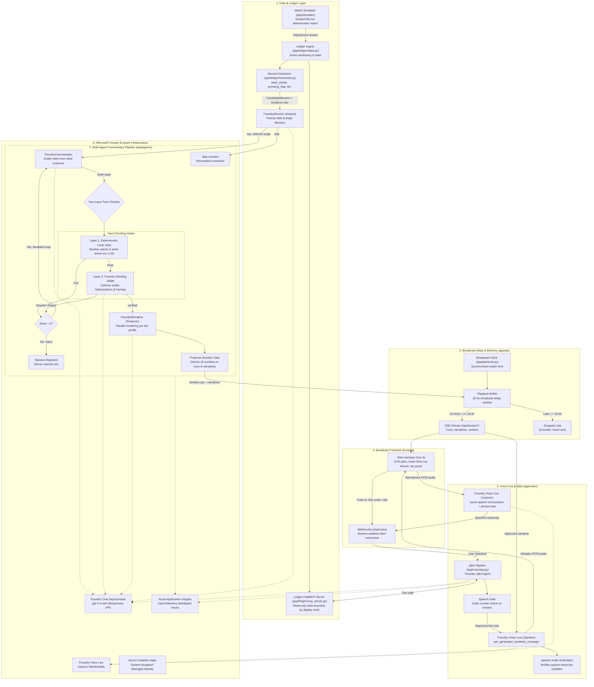
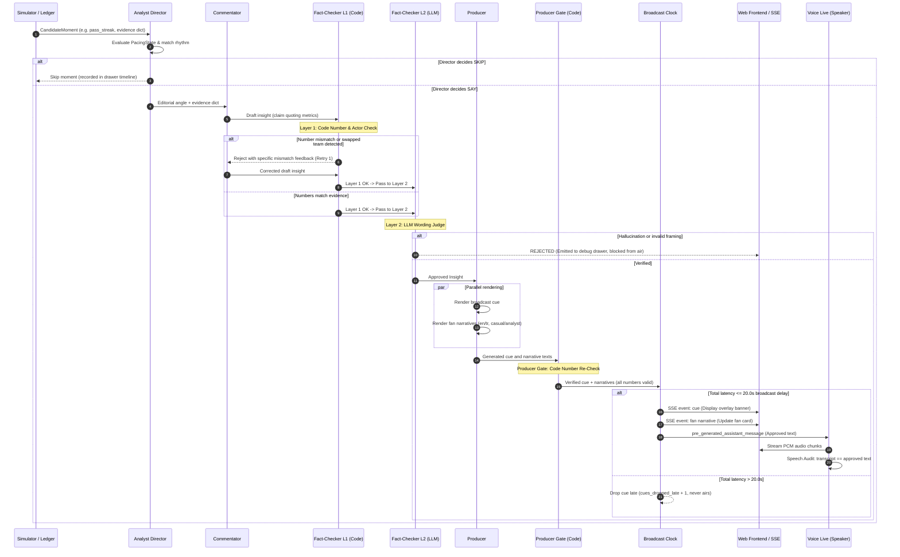
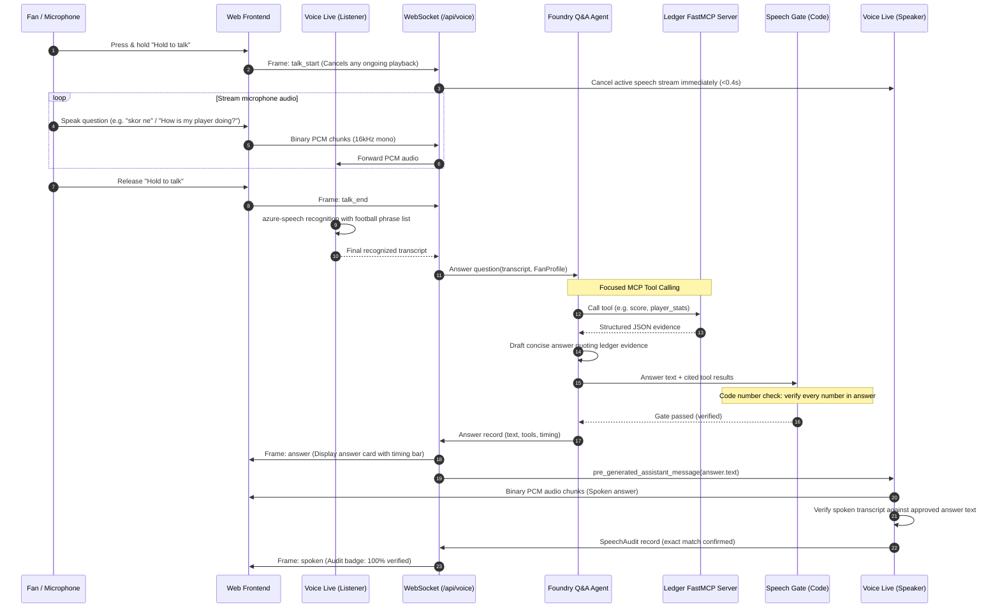

# Architecture: Matchday Companion

Matchday Companion is an AI co-commentary and broadcast overlay system designed around a foundational requirement: **it cannot lie on air**.

This document details the complete end-to-end architecture, the multi-agent pipeline, the two-layer verification gating, and the execution flow from raw match events to verified broadcast graphics and synthesized voice.

---

## 1. System Architecture

The following diagram illustrates the flow of data through Matchday Companion, from synthetic event generation through the ledger, agent workflow, broadcast delay clock, web delivery, and Microsoft Foundry services.

---

## 2. Pipeline Stages

The commentary pipeline enforces strict separation of concerns across deterministic code and model evaluation:

| Stage | Name | Implementation | Function | Inputs | Outputs | Gating / Guarantees |
|---|---|---|---|---|---|---|
| **1** | Simulator | Deterministic code (`app/simulator/engine.py`) | Generates realistic, seeded football events | Seed (int), match clock | `MatchEvent` stream | Fully reproducible: identical seed generates identical match events. |
| **2** | Ledger & Detectors | Deterministic code (`app/ledger/state.py`, `app/ledger/moments.py`) | Aggregates possession, shots, pass streaks, pressing traps | `MatchEvent` list | `CandidateMoment` + `evidence` dict | Pure calculation; no probabilistic logic. All numbers originate here. |
| **3** | FastMCP Server | FastMCP protocol (`app/ledger/mcp_server.py`) | Exposes read-only ledger tools (`score`, `team_stats`, `player_stats`, `recent_moments`) | Tool invocation request | Structured JSON records | Bound to playback display clock; cannot leak future match events. |
| **4** | Director (Analyst) | Foundry agent (`app/agents/analyst.py`) | Evaluates pacing state and decides whether to commentate or skip; selects tactical angle | `CandidateMoment`, `PacingState`, labels | `DirectorDecision` (`decision`: say/skip, `angle`, `reasons`) | Max tokens: 100. Skips low-interest moments or congested phases. |
| **5** | Commentator | Foundry agent (`app/agents/commentator.py`) | Drafts a factual commentary claim citing specific ledger metrics | `CandidateMoment`, labels, feedback | `Insight` (`claim`, `evidence_refs`, `why_it_matters`) | Max tokens: 250. Restricted to metrics present in the evidence dict. |
| **6** | Fact-Checker Layer 1 | Deterministic code (`app/agents/fact_check_rules.py`) | Parses every number in the claim and verifies exact match against cited evidence; verifies actor attribution | `Insight.claim`, `evidence` dict, labels | `NumberCheck` (`ok`, `mismatches`) | Zero LLM calls. If a number is wrong, missing, or an actor swapped, rejects immediately with feedback. |
| **7** | Fact-Checker Layer 2 | Foundry agent (`app/agents/fact_checker.py`) | Analyzes tone, framing, and catches subtle hallucinations that keep numbers right but state false facts | `Insight`, labels, `evidence` dict | `Verdict` (`status`: verified/rejected/rewrite, `layer`: llm, `reasons`) | Max tokens: 250. One retry loop allowed for rewrites; second rejection is terminal. |
| **8** | Producer | Foundry agent (`app/agents/producer.py`) | Renders verified insight into broadcast overlay cues and personalized narratives per fan profile | Verified `Insight`, `FanProfile` list | `ProducerOutput` (`cue`, `narratives`, `checks`) | Max tokens: 120 (cue), 180 (narrative). Rendered in English and Turkish across casual and analyst depths. |
| **9** | Producer Number Gate | Deterministic code (`app/agents/fact_check_rules.py`) | Re-verifies that every rendered cue and narrative contains only approved numbers | Rendered text, `evidence` dict, language | `NumberCheck` per profile | Zero tolerance for invented numbers during translation or style adaptation. |
| **10** | Broadcast Clock | Deterministic code (`app/api/clock.py`, `app/api/streams.py`) | Buffers events and cues behind a 20.0 s broadcast delay window | Processing timestamp, match clock | Emitted SSE event or dropped cue | If total pipeline latency > 20.0 s, cue is dropped late (`cues_dropped_late`) and never aired. |
| **11** | Voice Live Speaker | Foundry Voice Live WebSocket (`app/voice/session.py`) | Speaks verified narrative lines verbatim using pre-generated text | Approved text, voice configuration | Verbatim PCM audio stream | Uses `pre_generated_assistant_message`. The realtime model never authors spoken words. |
| **12** | Speech Audit | Deterministic code (`app/voice/session.py`) | Compares Voice Live speech transcript against approved input text | Audio transcript, approved text | `SpeechAudit` (`check`: true/false, `text`, `transcript`) | Discrepancies are recorded as audit failures and shown. |
| **13** | Voice Live Listener | Foundry Voice Live WebSocket (`app/voice/session.py`) | Captures push-to-talk audio and transcribes user speech with football phrase list bias | Raw PCM audio stream, language | Recognized question transcript | Session-isolated listening connection with turn-detection disabled. |
| **14** | Q&A Pipeline | Foundry agent + FastMCP (`app/voice/qa.py`) | Answers fan match questions by querying ledger MCP tools | Question transcript, `FanProfile` | `Answer` (`text`, `tool_calls`, `verdict`) | Max tokens: 150. Gated by code number check before text is returned or spoken. |

---

## 3. Execution Sequences

### Sequence 1: Moment Ingest, Verification, and Broadcast Cue Delivery

This sequence follows a single match event from simulation through the commentary pipeline, showing both the happy path and the rejection branch:

---

### Sequence 2: Push-to-Talk Fan Question over FastMCP

This sequence traces a fan interrupting the broadcast to ask a live match question:

---

## 4. Key Architectural Patterns

### 1. Two-Layer Fact-Checking (Code before Model)
Broadcasters cannot rely on an LLM alone to police another LLM. Matchday Companion uses deterministic code as the first and strictest filter:
- **Layer 1 (Code)**: Extracts all numbers in English and Turkish notations (`68%`, `%68`, `yüzde 68`, `14.0 passes`). It matches each extracted number against the ledger evidence dictionary and enforces actor attribution (a team cannot be attributed an opponent metric). This layer runs in sub-millisecond time with zero API cost.
- **Layer 2 (Model)**: Runs only after Layer 1 passes. It evaluates subtle semantic issues, tone, and scenarios where numbers are accurate but the qualitative claim is misleading (e.g. claiming a team was dominant when they were pinned in their half).
- See [ADR 0002: Numbers by Code](adr/0002-numbers-by-code.md).

### 2. Verbatim Speech Pipeline
Voice AI models in conversational mode hallucinate, round numbers, or rephrase statistics. Matchday Companion decouples generation from speech:
- The text generation pipeline produces and gates the exact sentence first.
- The approved string is sent to Foundry Voice Live using `pre_generated_assistant_message`.
- The Voice Live model acts purely as an audio synthesizer for the approved text; it is strictly prohibited from authoring words.
- An automated speech audit compares the emitted audio transcript against the source text to ensure 100% fidelity.
- See [ADR 0003: Verbatim Voice](adr/0003-verbatim-voice.md).

### 3. Broadcast Delay Window
Live broadcasts already run some seconds behind real time. Matchday Companion uses a 20 second delay:
- The simulation and agent workflow run in real-time ahead of the viewer playback clock.
- A 20.0-second delay window (`BROADCAST_DELAY_S=20`) gives the multi-agent pipeline sufficient time to analyze, draft, verify, and render multi-lingual graphics before the moment appears on the viewer screen.
- If a moment encounters network latency and exceeds the 20.0-second window, it is dropped late rather than popping up out-of-sync with the action.
- See [ADR 0004: Broadcast Delay](adr/0004-broadcast-delay.md).

### 4. Bounded Ledger over FastMCP
The FastMCP server exposes deterministic match statistics to the Q&A agent:
- Tools include `score`, `team_stats`, `player_stats`, `recent_moments`, and `squads`.
- All queries are bounded by the viewer's current playback clock, preventing the agent from leaking spoilers or stats from future match moments.
- See [ADR 0005: MCP Ledger Tools](adr/0005-mcp-ledger-tools.md).

### 5. Multi-Visitor Session Isolation and Spend Protection
Public web deployment requires deterministic isolation between independent visitors:
- Each browser session receives an isolated `mc_session` cookie routing to its own match state, event buffer, and FastMCP context.
- Rate limits protect live Azure spend: maximum 2 live matches per visitor IP per day, and a global daily cap of 40 live runs (`PUBLIC_LIVE_RUNS_TOTAL_PER_DAY=40`).
- When caps are reached, the application seamlessly falls back to offline template agents with an explicit user notice.
- See [ADR 0001: Per-Visitor Sessions](adr/0001-per-visitor-sessions.md) and [docs/deploy.md](deploy.md).
